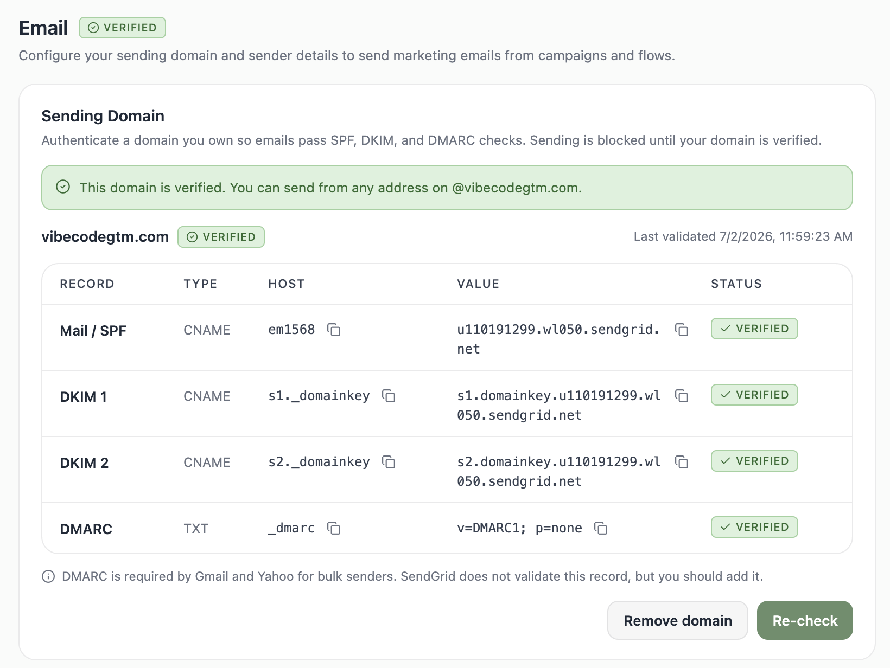
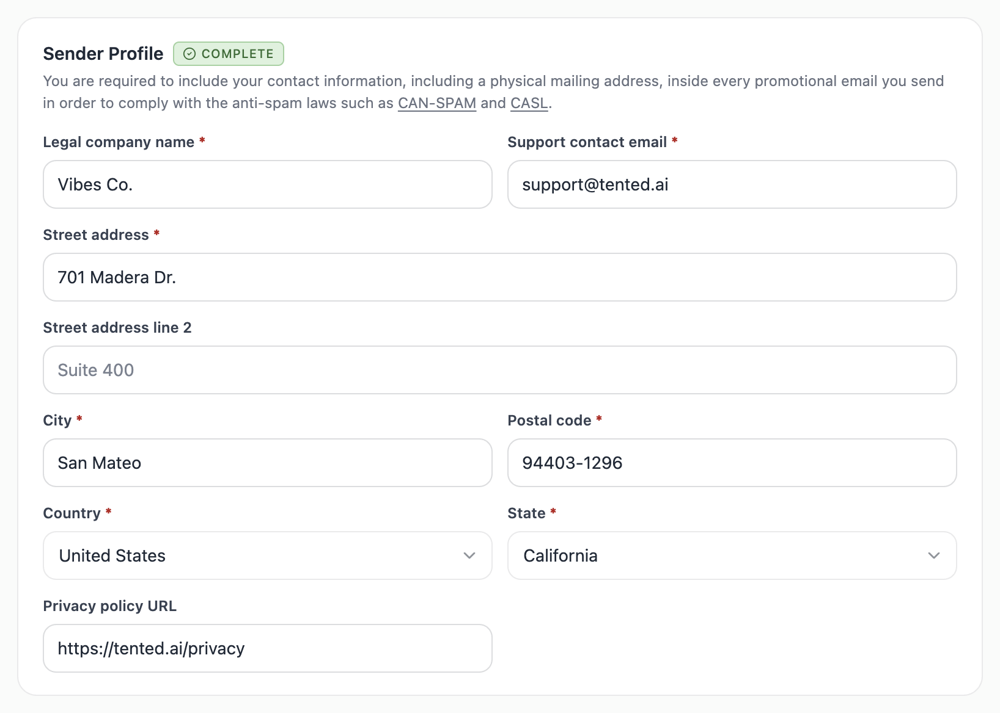
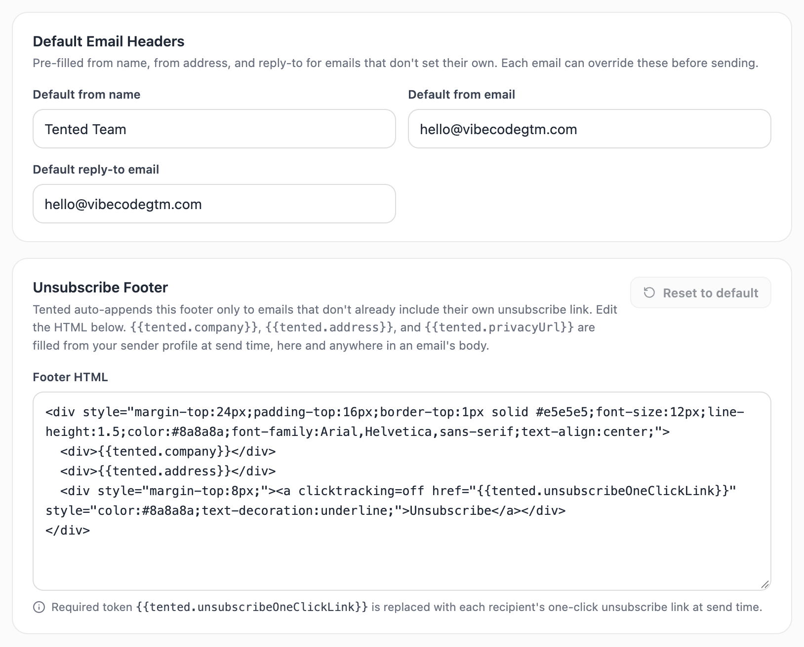

## Before you send

Tented sends marketing email from **your own domain** — which means better deliverability and emails that are unmistakably yours. Before your first campaign, there's a one-time setup: verify a sending domain and fill out your sender profile. Sending is blocked until your domain is verified, so this is step one.

Everything lives in one place: click your profile in the bottom-left corner, choose **Settings**, then choose **Email** in the settings menu.

## 1. Verify your sending domain

Add a domain you own, and Tented generates the DNS records that let mailbox providers verify your email is legit — SPF, DKIM, and DMARC.

<Note>
  Sending domains are available on **every plan, Free included** — verifying a domain is part of getting set up, not a paid feature. Free-plan limits apply to sending volume instead: 100 emails per day, and [flows require Pro or Max to activate](/email/triggered-flows#activate-it).
</Note>

1. Enter your domain (for example, `yourcompany.com`).
2. Copy each generated record — a few CNAMEs and a TXT — into your DNS provider (GoDaddy, Cloudflare, Namecheap, etc.).
3. Click **Re-check**. DNS changes can take a little while to propagate, so don't panic if it's not instant.

Once every record shows **Verified**, you can send from any address on that domain — `hello@yourcompany.com`, `news@yourcompany.com`, whatever fits.

<Warning>
  Sending is blocked until your domain is fully verified. If a record stays unverified, double-check for typos and make sure your DNS provider isn't proxying the CNAME records.
</Warning>

## 2. Complete your sender profile

Anti-spam laws like CAN-SPAM and CASL require every promotional email to include your contact information — including a physical mailing address. Your sender profile is where Tented gets it:

- **Legal company name** and **support contact email**
- **Street address**, city, postal code, state, and country
- **Privacy policy URL** (optional, but a nice touch)

These details are automatically merged into your email footers at send time, so you're compliant without thinking about it.

## 3. Set your default email headers

Save yourself some typing: set a default **from name**, **from address**, and **reply-to**. Every new email starts pre-filled with these, and you can always override them on a specific email before sending.

## 4. Review the unsubscribe footer

Marketing emails must include a working unsubscribe link. Tented auto-appends a footer to any email that doesn't already include its own — and you can customize its HTML here.

The footer supports tokens that are filled from your sender profile at send time:

- `{{tented.company}}` — your legal company name
- `{{tented.address}}` — your mailing address
- `{{tented.privacyUrl}}` — your privacy policy URL
- `{{tented.unsubscribeOneClickLink}}` — **required** — each recipient's personal one-click unsubscribe link

<Note>
  When a contact unsubscribes, Tented flips their **Unsubscribed** field and quietly excludes them from future marketing sends. You don't need to manage suppression lists yourself.
</Note>

## 5. Decide who else is held back

The **Send Suppression** panel shows who never receives a marketing blast or flow. Two rules are built in and cannot be changed:

- **Unsubscribed** is Yes. Operational sends bypass this one.
- **Marketing Email Invalid** is Yes (a hard-bounced address). This blocks every send, operational included.

On top of those you can add your own rules. Each rule names a Yes/No field and blocks the contact when the field is **No**, when it is **not set**, or both:

- **Marketing Email Subscribed** is where CSV imports and the Shopify integration record consent. Block when No and when not set, and only contacts who explicitly opted in receive marketing email. This is the right setting for a migration from another platform.
- Any **Yes/No custom field** works the same way, so a field like `gdprConsent` or `catalogOptIn` can gate sends without touching your audiences.

Added rules apply everywhere the built-in ones do: the blocked count when you pick an audience, the People list's blocked filters, blasts, A/B tests and flows. Operational sends ignore added rules. A rule on a custom field that is later archived stops applying on its own.

<Warning>
  Added rules only hold contacts back. They never change a contact's fields, so clearing a rule later lets those contacts receive mail again.
</Warning>

## Deliverability & suppression

A few behaviors worth knowing so your sends stay healthy:

- **Unsubscribes are honored automatically.** An unsubscribed contact is excluded from every future marketing blast and flow — you'll see them counted as **blocked** when you pick an audience. There's no re-subscribe flow, so if someone opts out, it sticks (they can be re-added only with fresh consent on your side).
- **Hard bounces suppress themselves.** When an address hard-bounces, Tented marks the contact's email invalid and excludes it from **every** future send — operational included, since the address simply can't receive mail. The flag is system-managed: it can't be set by hand or by imports, and it clears automatically if the contact's email address is updated.
- **Bounces and spam reports are tracked.** They show up in your [blast](/email/email-blasts) and flow results so you can spot problem addresses, and you can export the bounced bucket to clean your list.
- **One-click unsubscribe** is built in via the `List-Unsubscribe` header, so Gmail and Apple Mail show their native unsubscribe button — which protects your sender reputation.
- **Operational sends bypass the unsubscribe preference only** (password resets, security notices) — invalid, hard-bounced addresses stay excluded even there, and your added suppression rules are skipped. Keep that toggle off for anything promotional.

## You're ready to send 🎉

<Card
  title="Next: Creating Emails with AI"
  icon="arrow-right"
  href="/email/creating-emails"
>
  Describe the email you want and watch Tented write and design it for you.
</Card>
