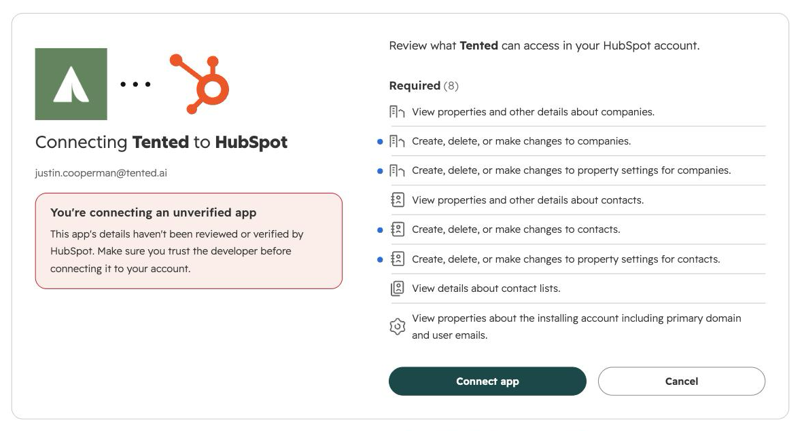
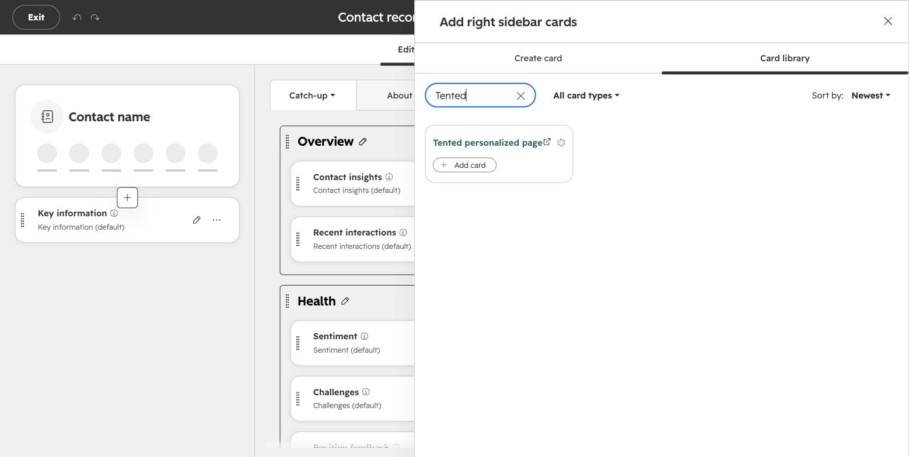
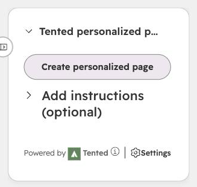
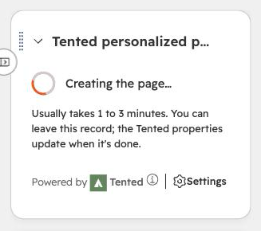
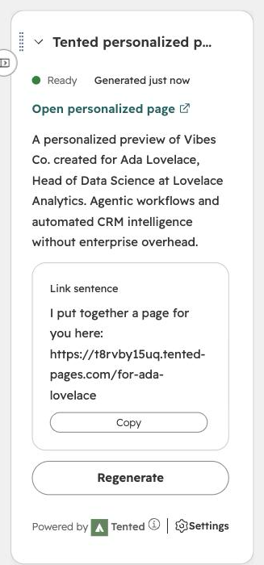
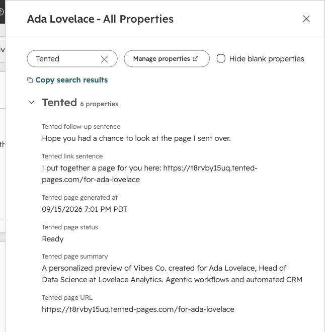

Tented connects to [HubSpot](https://www.hubspot.com) so any contact or company can get a personalized landing page built from one of your approved templates. A rep creates a page straight from the record with the Tented card in the sidebar, or Tented creates pages automatically for every record that joins a list you choose. Either way, Tented writes the page link, a short summary, and two ready-made sentences back to the record, so sequences and emails can use them as personalization tokens.

This guide covers connecting the two, choosing what to generate, automating with lists, using the card, and what to expect afterwards.

## Prerequisites

Before you begin, make sure you have:

- **Admin access** to your Tented workspace. Connecting, changing settings, and disconnecting are admin-only.
- **An approved tent template** in Tented. Pages are generated from a template's approved version. See [Templates](/working-with-tents/tent-templates) if you don't have one yet.
- **Permission to install apps in HubSpot**. Super admins have it; other users need the **App Marketplace access** permission.
- **AI credits**. Each generated page uses half a credit.

## Step 1: Connect HubSpot

1. In Tented, open **Settings → Integrations**.
2. On the **HubSpot** tile, select **Install**, then **Connect HubSpot**.
3. HubSpot opens in a new window. Pick the account to connect and approve access. The window closes on its own and Tented moves to the next step.

Tented asks for permission to read contact and company properties, write the page link and summary back to each record, create the six Tented properties, and read the lists you choose to watch.

<Note>
If you installed Tented from the HubSpot App Marketplace instead, HubSpot sends you to this same page in Tented with the connection already made. Sign in as a workspace admin to finish setup.
</Note>

## Step 2: Choose what to generate

- **Tented template**: the approved template each page starts from. Tented picks your most recently approved template; change it if you like. Every page is personalized to the record using all of its properties, and for a contact, its company's properties too.
- **Automatically create pages for**: optional. Pick a **contact list** and/or a **company list**. Tented checks them about every 15 minutes (or straight away when you select **Sync now** on the tile) and creates a page for every new member. Leave both on **None** to create pages only when someone clicks the card on a record.

### Advanced

Expand **Advanced** to change the copy Tented works from:

- **Page generation prompt**: the instructions the page is generated with. `{{hubspot.rowData}}` is replaced with every property on the record. Reps can also add one-off instructions from the card for a single page.
- **Link sentence**: written to the record as `tented_page_offer`. Use `{{url}}`, `{{first_name}}`, `{{company_name}}`, `{{job_title}}`, and `{{summary}}`. Leave it empty to skip it.
- **Follow-up sentence**: written as `tented_page_reference` for a later email or sequence step.

Select **Next: Contacts** to choose whether to sync contacts (below), then **Connect**. Tented adds a **Tented** property group with six properties to contacts and companies in your HubSpot account (see [Using the fields in HubSpot](#using-the-fields-in-hubspot)), then starts watching any lists you chose.

## Syncing contact data (optional)

Tented can also keep your HubSpot contacts in **People**, so lists, flows, and emails in Tented work off the same records your team uses in HubSpot. You choose this during setup on the **Contacts** step, and can change it later with **Edit** next to **Contacts** on the HubSpot tile.

Pick one of three options:

- **Don't sync contacts.** Records stay in HubSpot. Pages still work from the card and lists.
- **Import HubSpot contacts into Tented.** HubSpot contacts appear in People and are kept up to date about every 15 minutes. Tented never writes back.
- **Keep Tented and HubSpot in sync.** Changes flow both ways: HubSpot edits come in, and Tented edits and new Tented contacts go back to HubSpot.

Once you pick an option the three cards fold to one line; **Change** opens them again. Below it, the step shows what saving will do: how many contacts it will import from the portal or list and, with two-way sync, how many Tented contacts it will send to HubSpot and roughly how long that takes. A send of 10,000 contacts or more asks you to confirm it first. To send fewer, choose a list, or import only. On a sync that is already running the panel shows how many contacts are linked and when it last ran, and switches to **What changes when you save** once you change the mapping.

The mapping is four sections, each with its own add and remove controls. HubSpot properties carry the HubSpot logo, Tented fields the Tented mark.

### Match contacts by

How a HubSpot contact is matched to a Tented contact. A contact already synced stays linked to its record, whatever its email or phone now say. Otherwise Tented looks for a contact with the same email; only when the HubSpot contact has no email, or no contact has it, does Tented look for the same phone number. No match makes a new contact. The order is fixed. HubSpot's **Email** and **Phone Number** are mapped to Tented's **Email** and **Phone** by default; swap either for another HubSpot property (a work email, say) by removing the row and adding it again, and keep at least one.

### Mapping for Tented fields

HubSpot's standard properties (first and last name, company, job title, lead status, address, and so on) are matched to Tented's fields for you. Each row names the HubSpot property, the Tented field it fills, and what happens when the Tented contact already has a value: **Overwrite** or **Do nothing**. With two-way sync the rule works the same way in the other direction: a **Do nothing** field is only ever filled in on HubSpot's side, never replaced, so each side keeps its own value.

**Add a field** maps any other HubSpot property onto a Tented field, standard or custom. A custom field of your own works like a standard one: HubSpot's value comes in by the rule you chose, and with two-way sync Tented's value goes back. (The custom field stays yours; it is not removed when HubSpot is disconnected.) Email and Phone are not offered here, since they are identifiers.

HubSpot's **Lifecycle stage** is not matched to Tented's **Lifecycle Stage**. HubSpot gives every contact it creates the stage **Lead**, and its pipeline is HubSpot's, not Tented's. Add it as a HubSpot custom field if you want it on your contacts.

### Create new HubSpot custom fields

Any HubSpot property can also come in as a field of its own, in a **HubSpot fields** group on every contact. Select **Add a HubSpot field**, pick the property, and choose:

- **Read-only.** HubSpot owns the value; it shows on the contact but cannot be edited in Tented.
- **Editable.** Available with two-way sync. Edits in Tented are sent back to HubSpot.

These fields are marked as managed by HubSpot in People settings and are deleted when the integration is disconnected. Each one uses a custom field slot from your workspace's allowance; the section shows how many are left and the step will not save a mapping that does not fit. Dropdowns with more than 25 options, multiple-choice properties, and calculated properties come in as read-only text. File and rich-text properties cannot be synced.

### Unsubscribes

Opt-outs travel in both directions, and Unsubscribed only ever goes one way: a contact who unsubscribed in Tented is never re-subscribed by HubSpot.

**Unsubscribe in Tented when any of these is true in HubSpot.** HubSpot's **Unsubscribed from all email** flag is listed by default. HubSpot only sets it when a contact unsubscribes from everything; a contact who opts out of one subscription type (**Opted out of email: Marketing Information**, for example) keeps it off. **Add a HubSpot field** lists HubSpot's yes/no properties, the per-type opt-outs first; add any of them, and a contact with any one of them set is unsubscribed in Tented.

**When a contact unsubscribes in Tented** (two-way sync only). HubSpot does not let apps change its own opt-out, so choose what Tented tells HubSpot instead: set the **Unsubscribed in Tented** property Tented creates (the default), set a yes/no property of your own, or nothing. Build a HubSpot workflow on that property to stop HubSpot's own emails too. Whichever you choose, Tented itself stops sending to the contact.

### Limiting the sync to a list

**Only contacts in this HubSpot list** limits the sync to one list; leave it on **All contacts** to sync the whole account. Contacts in the list come in and, with two-way sync, go back.

A contact that leaves the list stops syncing in both directions from its next change onward. It picks up again when it rejoins, including any changes made in HubSpot while it was out. Contacts created in Tented are the one exception: once Tented has created them in HubSpot they stay in step whether or not they are in the list. Contacts that came from a list import or another integration are not sent to HubSpot while the sync is limited to a list.

### How changes are merged

Each sync applies only the properties HubSpot changed since the last one, so an edit made in Tented survives an unrelated HubSpot change. If the same field changed on both sides between two syncs, the HubSpot value wins. A property emptied in HubSpot is emptied in Tented too, unless its rule is **Do Nothing**; an emptied email or phone never empties Tented's copy.

With two-way sync, Tented sends only the fields that changed in Tented. Phone numbers keep HubSpot's own formatting until the number itself is changed in Tented. For a HubSpot dropdown, such as lead status, Tented sends the matching option; a Tented value HubSpot has no option for is left out, and the rest of the contact is still sent. A default HubSpot gives a contact it creates then fills that field in Tented only if it is empty.

While the first sync runs, the **Contacts** line on the tile shows the stage and how far along it is: reading contacts from HubSpot, importing them, then (two-way) sending Tented's contacts to HubSpot, with a rough time left. A two-way sync of 10,000 contacts or more is sent as HubSpot imports (one file per job, matched by email) instead of request by request, so it does not count against HubSpot's API limits; contacts without an email are sent the ordinary way. When HubSpot limits how fast Tented can read or send, the line says so and the sync continues on its own; that is not an error. If HubSpot stops taking new contacts altogether (a portal's contact limit), the line says so in amber and Tented tries again a day later, or as soon as you save the contact sync settings.

If HubSpot refuses a contact outright, the **Contacts** line on the tile shows how many contacts were not accepted and the reason for the latest one. A refused contact is sent again the next time it changes in Tented.

### The first sync

The first sync reads every contact in the account (or the chosen list) and imports them in one run. It shows in **People → Past imports** as a HubSpot initial sync with counts, and only rows that failed or were skipped are kept for review. There is no size limit: an account with millions of contacts is read over a few hours and imported in the background in batches, so the rest of your workspace stays responsive, and the sync picks up where it left off if anything interrupts it. A very large account can take a day to finish. After that, Tented picks up changes about every 15 minutes.

If part of the first sync fails, it is tried again automatically. If it keeps failing, the tile says so, and saving the contact sync settings starts it over. Changing the mapping or the list later re-reads the account with the new settings; contacts already in Tented are updated, not duplicated.

Contacts created by the sync show **HubSpot** as their source. The **Contacts** line on the HubSpot tile shows the sync mode, how many contacts are linked, when the last sync ran, and how many contacts HubSpot did not accept.

### Removing HubSpot fields

Removing a field from the mapping removes it and its values from every contact. Lists and flows whose rules, triggers, or steps used it keep running, with those conditions matching nobody, and show **Needs attention** (in the lists table, the flows table, and the flow editor) until you change them. Disconnecting HubSpot does the same for all HubSpot fields; see [Disconnecting](#disconnecting).

## Step 3: Add the Tented card to records

HubSpot only shows an app's card on records after someone adds it to the record view. Tented can't do this for you, so the last step of setup in Tented walks you through it:

1. Open any contact in HubSpot.
2. Select **Customize record** at the top of the record, then **Default view**.
3. In the right sidebar, select **+** where the card should sit, choose **Tented personalized page**, and save.
4. Repeat on a company.

If you installed Tented from the HubSpot App Marketplace, a Super Admin can add it to every view at once instead: open **Settings → Integrations → Connected apps**, select **Tented**, open the **App cards** tab, and select **Manage locations**.

<Note>
Pages for the lists you chose in Step 2 are created without the card. The card is for creating a page from one record by hand.
</Note>

## Step 4: Create a page from a record

Open any contact or company in HubSpot. The **Tented personalized page** card sits in the right sidebar.

- Select **Create personalized page**. Expand **Add instructions** first if this page needs something specific, such as leading with a recent funding round.
- The card shows **Creating the page…** while Tented works, usually one to three minutes. You can leave the record; the Tented properties update when it's done.
- When the page is ready, the card shows the link, the summary, and the link sentence to paste into an email.

To replace a page, select **Regenerate** on the card. The record keeps its old link until the new page is ready.

<Tip>
Don't see the card? It hasn't been added to the record view yet. See [Step 3](#step-3-add-the-tented-card-to-records).
</Tip>

## Using the fields in HubSpot

Tented writes these properties to every contact or company it makes a page for:

| Property | What it holds |
| --- | --- |
| `tented_page_url` | The published page's link |
| `tented_page_summary` | A one-line description of the page |
| `tented_page_offer` | The link sentence, ready to paste |
| `tented_page_reference` | The follow-up sentence |
| `tented_page_status` | `Generating`, `Ready`, or `Failed` |
| `tented_page_generated_at` | When the page was last published |

Insert them as personalization tokens wherever HubSpot offers its **Personalize** menu, such as a sequence step, a sales email template, or a marketing email: pick the contact (or company) property named **Tented page offer**. Filter a list or branch a workflow on **Tented page URL is known** so only records with a live page get the step that links to it. Prefer the URL over **Tented page status is Ready**: while a page is being regenerated the status reads **Generating** for a few minutes even though the existing link still works.

## What happens after connecting

- The HubSpot tile shows **Connected**, the account, and which lists create pages automatically.
- Pages are published at readable URLs under your Tented domain, such as `https://your-domain/for-ada-from-analytical-engines` for a contact or `https://your-domain/for-acme-co` for a company.
- Select **View activity** on the tile to see each sync, how many pages were created, and any records Tented skipped and why. When contact sync is on, the same dialog lists each contact sync pass: the initial sync and every pass of changes since, with the contacts imported, sent to HubSpot, and refused, and the reason when a pass stopped early. **Sync now** checks your lists straight away instead of waiting for the next pass.
- Generated tents appear in **Content > Tents** with **HubSpot Integration** as the creator. Turn on **Hide integration tents** in the filter bar to keep them out of the way.

## Changing settings

Select **Edit settings** on the HubSpot tile to change the template, the watched lists, the prompt, or the sentences on the **Pages** tab, or contact sync on the **Contacts** tab. Records that already have a page are not regenerated when settings change.

## Disconnecting

Select **Disable** on the HubSpot tile. Tented stops creating pages for new list members and the card in HubSpot shows as not connected. Pages already generated, and the Tented properties already written to your records, are not deleted.

If contact sync was on, the **HubSpot fields** group and its values are removed from every contact; the contacts themselves, and everything in their standard fields, stay in Tented. The confirmation names any lists or flows whose rules use those fields. Those keep running (a rule on a removed field simply matches nobody) and show **Needs attention** until you change the rule. If you connect the same HubSpot account again, its fields and contact links from before are kept.

Uninstalling the Tented app from HubSpot (**Settings → Integrations → Connected apps**) is noticed by Tented once HubSpot's current access token expires, usually within 30 to 45 minutes: the tile shows **Paused** with **HubSpot access was revoked**, and any requests that were waiting are kept until you select **Reconnect HubSpot**. To remove the connection entirely, select **Disable** in Tented as well.

<Warning>
Uninstalling the app in HubSpot also removes the Tented card from every record view. After you reconnect or reinstall, add the card again as in [Step 3](#step-3-add-the-tented-card-to-records); the pages and properties on your records are unaffected.
</Warning>

## Troubleshooting

| What you see | What it means | What to do |
| --- | --- | --- |
| **Paused: out of AI credits** | Your workspace ran out of credits | Add credits; pages resume automatically |
| **Paused: published-tent limit reached** | Your plan's published page limit is full | Unpublish pages or upgrade |
| **Paused: HubSpot access was revoked** | The app was uninstalled in HubSpot, or the user who connected it lost access | Select **Reconnect HubSpot** on the tile |
| **Paused** with a settings message | The template or a watched list is no longer usable | Select **Review settings** |
| No Tented card on contact or company records | The card hasn't been added to the record view | Follow [Step 3](#step-3-add-the-tented-card-to-records) |
| The card says **Connect this HubSpot account to Tented** | This HubSpot account isn't connected to a Tented workspace | Connect from **Settings → Integrations** in Tented |
| **This HubSpot account is already connected to another Tented workspace** | One HubSpot account can only feed one workspace | Disconnect it there first |
| The card shows **Failed** | Generation didn't complete, or the record was deleted while it ran | Select **Try again**; check the Activity dialog for the reason |
| A list member didn't get a page | It already had one, or it joined before the list was chosen | Open the record and use the card |
| **This mapping needs N custom field slots but the workspace has M left** | Your workspace is near its custom-field allowance | Remove HubSpot fields from the mapping, or archive unused custom fields in People settings |
| **Paused** with **Contact sync: "property" no longer exists in HubSpot** | A mapped property was deleted in HubSpot | Select **Edit** next to Contacts and remove or replace the field |
| A list or flow shows **Needs attention** | A rule uses a HubSpot field that was removed from the mapping or with the disconnect | Open the rule and replace the condition |
| The tile shows **N not accepted by HubSpot** | HubSpot refused those contacts; the latest reason is shown next to the count | Fix the value HubSpot names on the contact in Tented; it is sent again on its next change |
