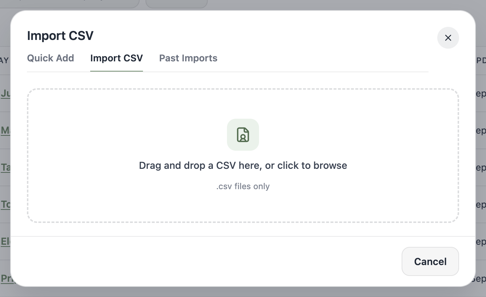
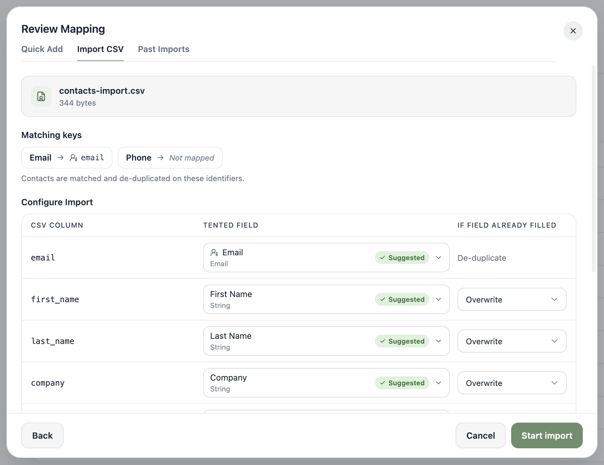
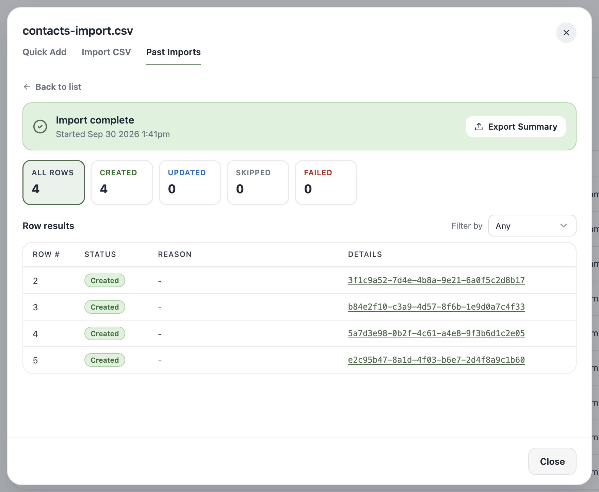

## Before you import

Any CSV with a header row works. A typical file looks like this:

```csv
email,first_name,last_name,company,job_title
diego.ramirez@northwindsupply.com,Diego,Ramirez,Northwind Supply,VP of Marketing
priya.patel@brightlabs.co,Priya,Patel,Bright Labs,Demand Gen Manager
```

### What a valid file looks like

- **It's a real CSV.** In Excel, Google Sheets or Numbers, export or download the sheet as a CSV. Renaming an `.xlsx` file to `.csv` doesn't convert it.
- **Values are separated by commas and the file is saved as UTF-8.** In Excel, pick **CSV UTF-8 (Comma delimited)**. Google Sheets and Numbers do this for you.
- **The first row holds your column names**, with at least one contact below it.
- **There's an email or phone column.** Every contact needs one or the other, so rows without either can't be created.
- **It's 350 MB or smaller.** Split anything larger into separate files.

### Good to know

- Column names don't need to match Tented's field names. You'll get a mapping step.
- Columns can map to [custom fields](/people/contact-fields) too, and you can create new custom fields during the import.
- Blank rows are skipped.
- Repeated column names are fine. If your sheet has two columns called `Comment`, the first is mapped as usual and the second shows up as `Comment (2)`, set to **Ignore column**. Pick a field for it if you want that data too.

## Step 1: Upload your file

Go to **People > Add > Import from CSV** and drag your file in (or click to browse).



## Step 2: Map your columns

Tented reads your header row and auto-maps each CSV column to a contact field. For each column you can:

- **Change the target field**: any [standard or custom field](/people/contact-fields)
- **Skip it**: choose **Ignore column** and that column isn't imported
- **Choose the overwrite behavior**: if a contact already exists (matched by email or phone), decide whether the imported value should **overwrite** a field that's already filled or leave it alone

At least one column has to be mapped to **Email** or **Phone** before you can start the import.



<Note>
  Imports **update** existing contacts rather than creating duplicates. A row whose email or phone matches an existing contact updates that contact according to your overwrite settings.
</Note>

## Step 3: Start the import

Click **Start import** and watch rows process in real time. When it finishes you get a full report:

- **Created / Updated / Skipped / Failed** counts, with a filterable row-by-row breakdown
- A **reason** for every skipped or failed row
- **Export Summary** to download the results for your records



## Troubleshooting your file

If Tented can't read your file, the upload step tells you why. Here's what each message means and how to fix it.

| Message | What to do |
| --- | --- |
| That file isn't a CSV | The file name doesn't end in `.csv`. Export or download the sheet as a CSV from your spreadsheet app. |
| This doesn't look like a CSV file | The file is a spreadsheet that was renamed to `.csv`, or it was saved in an encoding Tented can't read. Export it again as a CSV (UTF-8). |
| This file is empty | The file has no content. Add a row of column names and at least one contact. |
| This file has column names but no contacts | Only the first row has anything in it. Add your contacts below the column names. |
| This file has a quotation mark that is never closed | A value starts with `"` and never ends. Exporting the sheet again from your spreadsheet app fixes this; hand-edited files are the usual cause. |
| This file is larger than the 350 MB limit | Split the file and import the pieces one at a time. |
| We couldn't upload your file, or We couldn't read your file | Usually a connection hiccup. Remove the file and upload it again. |

A few problems don't produce a message:

- **Everything lands in one column on the mapping step.** The file uses semicolons or tabs between values instead of commas, which is common for Excel in some regions. Save it again as a comma-separated CSV.
- **Names show odd characters**, like `é` where an `é` should be. The file wasn't saved as UTF-8. Export it again with UTF-8 encoding.
- **Rows were skipped or failed.** The import report lists a reason for each one. The most common is a row with no email or phone.

## Reviewing past imports

The **Past Imports** tab in the **Add people** dialog keeps a history of every import — handy when you're trying to work out where a contact came from. Each contact's [Activities timeline](/people/managing-contacts#viewing-a-contact) also records "Person Created — Source: List Import."

## What's next?

<Columns cols={2}>
  <Card
    title="Organize them into lists"
    icon="list"
    href="/people/working-with-lists"
  >
    Turn your imported contacts into targeted audiences.
  </Card>
  <Card
    title="Customize your fields"
    icon="table-columns"
    href="/people/contact-fields"
  >
    Add custom fields so your CSV columns have a proper home.
  </Card>
</Columns>
