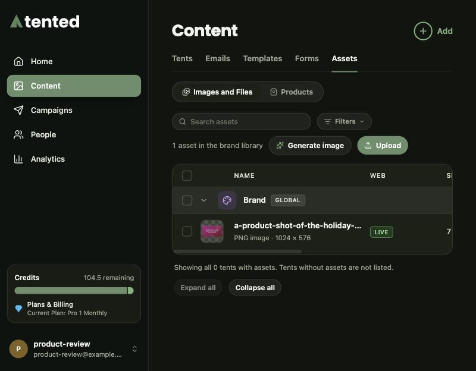
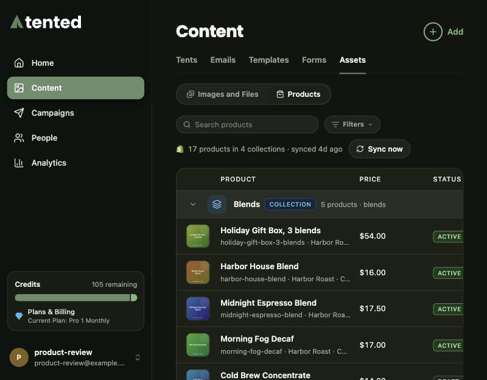

## The Assets page

**Content > Assets** lists every image and file your workspace holds, grouped by where it lives, with the tools to upload, generate, publish and tidy them. When Shopify is connected, a second view, **Products**, shows your synced catalog.

## Images and Files

Assets are grouped:

- **Brand** comes first: your logo and icon from Settings, plus the brand library. Brand files are managed on their own and stay until you remove them.
- **Each tent** that has assets follows, with everything uploaded to it or generated for it. A tent's files are deleted with the tent.

Collapse or expand groups as you like, search by file name, and use **Filters** to narrow by type (images or files), web status, tent, or sort order.

### Working with a file

Hover a row for the quick actions, or open its menu for everything:

- **Preview** opens the file large, with previous and next and the file's details.
- **Open on the web** opens the public link.
- **Copy URL** copies that link, so you can paste it into a prompt or anywhere else.
- **Download** saves the original.
- **Rename** changes the display name.
- **Unpublish** or **Publish** controls whether the file is on the web (below).
- **Delete** removes the file for good.

Select several rows to publish, unpublish or delete them together.

### On the web, or not

The **Web** column says whether a file is reachable by its public link:

- **LIVE**: the link works.
- **NOT LIVE**: the file is published, but the tent it belongs to isn't, so its link won't work until the tent is published.
- **UNPUBLISHED**: you took the file off the web. It stays in your assets and you can still preview and download it, but its public link stops working and **Copy URL** is off until you publish it again.

<Note>
  Unpublishing really takes the file off the web: the file is moved out of public storage. Publishing puts it back at the same link.
</Note>

### Upload

Click **Upload**, choose where the files go, and pick the files. Files on a tent are deleted with that tent; brand files stay until you remove them. Each one shows its progress. Leave **Publish to the web** on to give the files public links right away, or turn it off to keep them private until you need them.

### Generate an image

You can ask the Image Agent for images here, without opening an editor. Click **Generate image**, describe the image, and choose:

- **Save to**: the brand library or a tent.
- **How many**: one to five images.
- **Shape**: landscape, portrait or square.
- **Use brand context**: your colors, logo and guidelines shape the result.
- **Publish to the web**: give each image a public link as soon as it's ready.

Each image costs **0.5 AI credits**, shown before you start. Generation runs in the background: close the dialog if you like, and the new row shows the Image Agent's progress until the image is ready. It's the same Image Agent as in the editor chat; see [Generating Images with AI](/working-with-tents/generating-images).

## Products

With Shopify connected, the **Products** view lists your synced catalog grouped by collection, with each product's price and status: **Active**, **Draft**, **Archived** or **Out of stock**.

The list is read-only; manage products in Shopify. Changes there reach Tented on their own, and **Sync now** reads the whole catalog again. To use products in a page or email, ask for them in the editor chat: see [Adding Products from Shopify](/working-with-tents/using-shopify-products).

If Shopify isn't connected, the view offers to connect it. See [Connecting Shopify](/integrations/connecting-shopify).

## In the editor

The editor's **Manage Assets** window (the image icon in the top bar) still shows the files of the tent or email you're working on, including whether each one is on the web. To create new images, ask in the chat or use the **/images** command.

<Card
  title="Next: Adding Products from Shopify"
  icon="arrow-right"
  href="/working-with-tents/using-shopify-products"
>
  Ask for products in chat and confirm the matches.
</Card>
