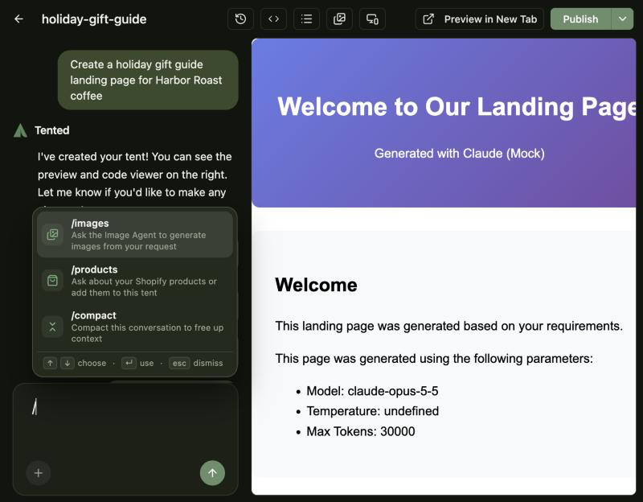
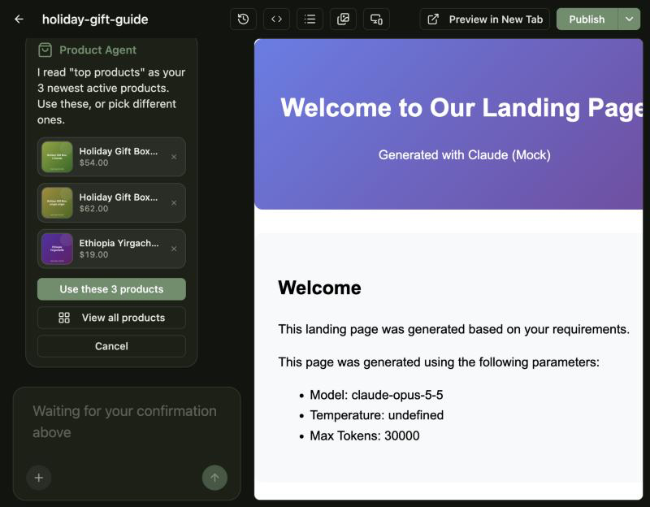
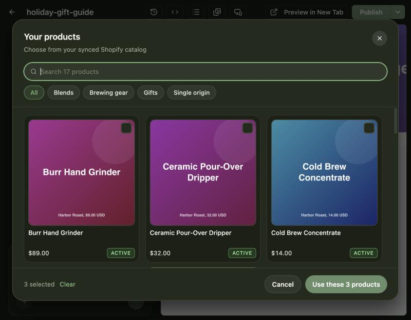

## Your catalog, in the editor

Once [Shopify is connected](/integrations/connecting-shopify), Tented keeps a copy of your store's products and collections. The editor chat can read it: ask for products in plain words and the **Product Agent** finds them, shows you what it found, and adds them to your page or email with their prices and links. It can also hand a product photo to the Image Agent as the reference for a new image.

This works in the tent editor, the email editor, and both template editors. You can browse the same catalog on **Content > Assets > Products** (see [Managing Your Assets](/working-with-tents/managing-assets#products)).

## Ask for products

Describe what you want, the way you describe any other change:

> Add our three newest coffees to the page, with prices.

> Put the holiday gift box in the hero section with a link to buy it.

If you'd rather be explicit, type `/` in the chat box. A list of commands opens; choose **/products** (or just keep typing `/products`), and the command shows in blue at the start of your message.

<Tip>
  The chat box says **Type / for commands** when you click into it. **/images** sends a request straight to the Image Agent, **/products** to the Product Agent, and **/compact** tidies a long conversation.
</Tip>

## Confirm the matches

Tented never adds products without showing you first. The Product Agent card lists what it found, with a thumbnail and price for each product:

- Remove a product with its **x**.
- Click **Use these N products** to go ahead.
- Click **View all products** to pick from your whole catalog instead.
- **Cancel** drops the request. Nothing changes and nothing is charged.

You can use up to five products in one request.

### View all products

**View all products** opens your synced catalog. Search by name, filter by collection, and click products to pick them. The count at the bottom keeps track, and **Use these N products** sends your picks.

Products that are **Draft** or **Archived** in Shopify are shown but can't be picked, because they aren't for sale. **Cancel**, the close button or **Escape** closes the window without changing the card.

### What gets added

Tented adds the products the way the rest of the design works: each one with its name, price and a link to its page in your store. When the change is done, the reply shows the products it used, and you can keep iterating ("make the product cards two columns", "show the prices in bold").

## Use a product photo in a new image

Name a product in an image request and Tented uses its store photo as the reference, so the item looks right:

> Make an image of a woman holding our holiday gift box in front of a fireplace.

If one product clearly matches, Tented confirms it. If several match, the card asks which one you mean, and you pick one (or open **View all products**). **Generate without a product** makes the image from your description alone. Then the usual image flow follows: one image generates right away, and two to five images ask you to confirm the credit cost first. See [Generating Images with AI](/working-with-tents/generating-images).

<Note>
  A product without a photo in Shopify can be added to a page or email, but it can't be an image reference.
</Note>

## Good to know

- **Active products only.** Only products that are active in Shopify can be used. If a product was archived after Tented offered it, the card tells you which one and lets you pick another. A product that is out of stock can still be used; the catalog marks it **Out of stock**.
- **Cards wait 30 minutes.** If you leave a card unanswered that long, Tented drops the request and frees the chat box. Send your message again when you're ready.
- **Everyone sees the card.** A teammate who opens the same editor sees the card too, and can answer it. If they do, you see a note instead of the card.
- **Ask how it works.** "/products how does this work" or "How do I ask for products from my catalog?" gets an answer in chat. Nothing is generated and no credits are used.
- **Keeping the catalog fresh.** Changes in Shopify reach Tented on their own. **Sync now** on **Content > Assets > Products** reads the whole catalog again.

<Card
  title="Next: Managing Your Assets"
  icon="arrow-right"
  href="/working-with-tents/managing-assets"
>
  Every image, file and product in your workspace, in one place.
</Card>
